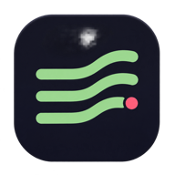
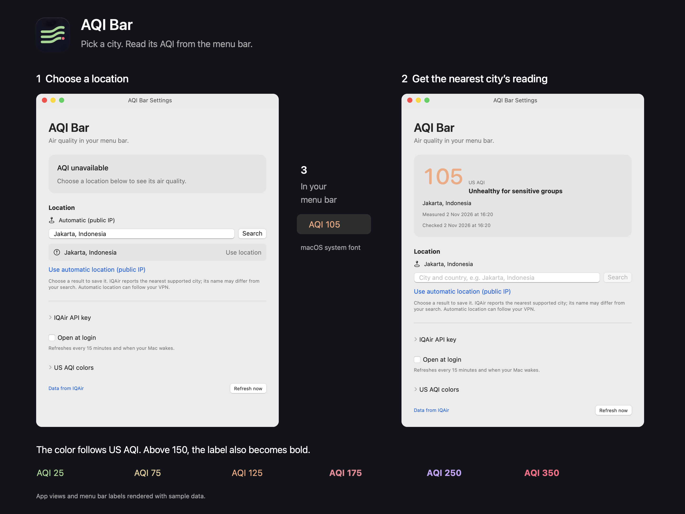

<p align="center">
  
</p>

# AQI Bar

Air quality in your Mac’s menu bar. Pick a city and see its US AQI in the system font. The number changes color as air quality gets worse, and turns bold above 150.



*The app views above use sample data.*

## Install

[Download AQI Bar for Apple silicon](https://github.com/frizurd/aqi-bar/releases/latest). After unzipping, drag **AQI Bar.app** into Applications and open it. You'll need macOS 13 or later; the ZIP is for Apple silicon.

The download is ad hoc signed, not notarized by Apple. You can also build it yourself; Intel Macs need a local build.

## Set your location

1. Open AQI Bar. Settings appears on first launch.
2. Expand **IQAir API key** and paste your [free IQAir Community key](https://www.iqair.com/air-pollution-data-api).
3. Search for a city and country, then click **Use location** beside the result you want.

The app saves your choice. Click the menu bar number to see the reporting city, measurement time, and last check. You can refresh or change location from that menu.

IQAir returns the nearest supported city, which may have a different name from the place you picked. **Automatic location** uses your public IP instead; a VPN can change that result.

## Colors

| US AQI | Category | Color |
| --- | --- | --- |
| 0–50 | Good | Green |
| 51–100 | Moderate | Yellow |
| 101–150 | Unhealthy for sensitive groups | Orange |
| 151–200 | Unhealthy | Red |
| 201–300 | Very unhealthy | Purple |
| 301+ | Hazardous | Pink |

The colors come from the original SketchyBar plugin. AQI Bar runs on its own; SketchyBar isn't required.

## Refreshes and missed readings

Leave it running and readings refresh every 15 minutes. Waking your Mac triggers another check. If the connection drops, it tries again after 10, 20, and 40 seconds.

A trailing dot (`AQI 160 ·`) means the reading is old or a refresh failed. Open the menu for **Last known** and the timestamps. A reading counts as old after 30 minutes without a successful check, or three hours since measurement. Changing cities clears the previous reading immediately.

## Data and API keys

Location searches go to Apple Maps. The selected coordinates go to IQAir. The app doesn't ask for device-location access.

Keys entered in Settings are saved to macOS Keychain. Your chosen location and latest reading are saved locally. For existing SketchyBar users, first launch can copy the plugin's IQAir key into Keychain.

## Build

With Xcode 15 or newer installed:

```sh
git clone https://github.com/frizurd/aqi-bar.git
cd aqi-bar
./build.sh
open "build/AQI Bar.app"
```

To run the tests:

```sh
xcrun swift test --disable-sandbox
```

The build uses Apple frameworks and has no third-party package dependencies. See [development notes](docs/development.md) for the code layout and screenshot renderer.
